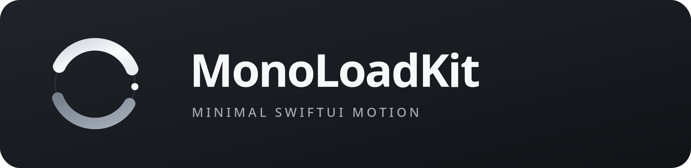
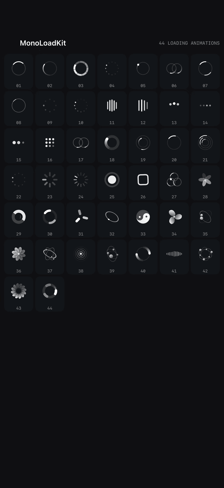

# MonoLoadKit



**44 款（原有 32 款 + 新增 12 款）极简 SwiftUI Loading 动画，可通过 Swift Package Manager 直接引入。**

     

[English](README.md) · [许可证](LICENSE) · [Demo](Examples/MonoLoadDemo)

<p align="center">
  
</p>
*Demo 画廊实机录制 —— 44 款动画同屏（深色主题）。*

## 核心特点

- **44 种独立样式**：圆弧、粒子、竖线、交叠双环、几何形状等。
- **100% 原生 SwiftUI**：基于 `Canvas` 矢量绘制，不播放 GIF，不依赖第三方库。
- **可配置**：尺寸、颜色、速度、播放/暂停。
- **暂停后从原进度恢复**：`MonoLoadingView` 持续维护自身播放时钟。
- **支持辅助功能**：系统启用“减少动态效果”时使用静态展示。
- **性能友好的展示方式**：一次展示 44 款时，使用一个 `TimelineView` 驱动所有可见单元，而非分别创建 Timer。
- **独立 iOS Demo**：搜索、类别筛选、深浅模式、速度/尺寸控制、暂停、单项放大预览、复制调用代码。
- MIT 开源许可，零第三方依赖，不配置 GitHub Actions。

## 兼容性

Swift 5.9+、iOS 16+、macOS 13+、tvOS 16+，推荐使用最新版 Xcode 编译。当前交付包含 Swift 源码与完整 Xcode Demo 工程，但请在 macOS/Xcode 中进行最终编译与设备测试。

## 接入方式

将仓库放到本地，在 Xcode 中选择 **File → Add Package Dependencies → Add Local…**，选中仓库根目录，添加 `MonoLoadKit` 产品到应用 Target。

发布到 GitHub 后，也可以使用仓库 URL 按照 Swift Package Manager 方式添加：

```swift
.package(url: "https://github.com/wangjianqi/MonoLoadKit.git", from: "1.1.0")
```

```swift
import SwiftUI
import MonoLoadKit

// 推荐的默认样式：02 流动月牙
MonoLoadingView(
    style: .flowingCrescent,
    size: 28,
    color: .primary,
    speed: 1,
    isAnimating: true
)

// 19 反向双弧
MonoLoadingView(style: .counterRotatingArcs, size: 32)
```

组件只负责绘制，不自动添加遮罩、毛玻璃卡片、提示文字、阻止交互或更改业务状态。是否覆盖页面、何时显示、是否允许取消，由宿主应用决定。

### 同屏展示 32 款

建议使用 **一个 `TimelineView` + 44 个 `MonoLoadingGlyph`**，避免给每个网格单元单独创建刷新时钟：

```swift
TimelineView(.animation(minimumInterval: 1.0 / 30.0)) { frame in
    LazyVGrid(columns: [GridItem(.adaptive(minimum: 110))]) {
        ForEach(MonoLoadingStyle.allCases) { style in
            MonoLoadingGlyph(
                style: style,
                size: 48,
                elapsed: frame.date.timeIntervalSinceReferenceDate
            )
        }
    }
}
```

## 新增 12 款（33–44）

原 32 款样式及其编号保持不变。新增款包括：

| 编号 | Swift API | 设计 |
|---|---|---|
| 33 | `.liquidYinYang` | 太极流转增强版：完整 S 形曲面 + 阴阳点 + 旋转 |
| 34 | `.silkThreeBlade` | 三叶风车增强版：弯曲叶片 + 光影过渡 |
| 35 | `.twinStarOrbit` | 双星轨道 |
| 36 | `.petalBloom` | 花瓣脉冲 |
| 37 | `.crossingEllipses` | 椭圆双环 |
| 38 | `.rippleCore` | 涟漪同心 |
| 39 | `.planetChase` | 行星追逐 |
| 40 | `.duoCrescents` | 双月对旋 |
| 41 | `.microWave` | 微光脉线 |
| 42 | `.orbitalWreath` | 轨道花环 |
| 43 | `.spiralTurbine` | 旋翼矩阵 |
| 44 | `.magneticRing` | 极简磁环 |

Demo 新增了 **New 12** 筛选入口，可查看新增动画。全部动画仍由 SwiftUI Canvas 在运行时实时绘制，不播放 GIF。

## Logo 与图标

- `Brand/MonoLoadMark.svg`：正方形 SVG 母版。
- `Brand/MonoLoadMark-Transparent.svg`：透明 Logo，可用于 GitHub 页面。
- `Brand/MonoLoadLockup.svg`：横向字标。
- Demo 的 `Assets.xcassets/AppIcon.appiconset` 已配置完整 1024×1024 App Icon。
- Demo 首页已引用 `BrandMark`，无需手动替换图片。

## 启动 Demo

1. 保留解压后完整文件夹结构。
2. Xcode 打开 `Examples/MonoLoadDemo/MonoLoadDemo.xcodeproj`。
3. 选择 `MonoLoadDemo` Scheme。
4. 选择 iOS 16+ 模拟器，直接运行。
5. 在画廊中筛选、搜索或点击任意样式进入大图预览。

Demo 已通过 Xcode 本地包引用 `../..` 关联根目录的 Swift Package，无需联网下载依赖。真机运行时需按 Xcode 提示选择签名团队。

## API

| 属性 | 类型 | 默认 | 说明 |
|---|---|---|---|
| `style` | `MonoLoadingStyle` | `.flowingCrescent` | 44 款动画任选 |
| `size` | `CGFloat` | `28` | 单位 pt |
| `color` | `Color` | `.primary` | 随系统深浅模式变化 |
| `speed` | `Double` | `1` | 倍速，`0` 冻结 |
| `isAnimating` | `Bool` | `true` | 动画是否运行 |

所有样式完整名称请参考 [README.md](README.md#32-styles) 与 `MonoLoadingStyle.swift`，包含英文和中文标签。

## 验证

Mac 上运行：

```bash
./Scripts/verify.sh
swift test
xcodebuild -project Examples/MonoLoadDemo/MonoLoadDemo.xcodeproj \
  -scheme MonoLoadDemo \
  -destination 'generic/platform=iOS Simulator' \
  CODE_SIGNING_ALLOWED=NO build
```

详细验收清单参考 [QA-CHECKLIST.md](QA-CHECKLIST.md)。源代码语法和 SPM 清单可在 Linux 验证；**无法代替 Xcode 的 SwiftUI 编译、iOS 模拟器实际运行和性能测试**。

## 开源

[MIT 许可证](LICENSE)。欢迎通过 Issue / PR 提出新的矢量动画和性能改进。参见 [CONTRIBUTING.md](CONTRIBUTING.md)。

## 极简模式与 GitHub GIF 录制

Demo 现在包含三种展示模式：

- **Standard（标准）**：原有的完整卡片、分类筛选与单项预览。
- **Minimal grid（极简）**：仅显示编号和动画，使用高密度网格，并保留播放/暂停与深浅色切换。
- **Capture GIF（录制）**：自动将全部 44 款排在一屏，隐藏状态栏和多余控件，适合录制 GitHub README 动图。**双击屏幕退出录制模式**。

在 Mac 上运行 Demo，进入极简模式，点击 **Capture GIF**。安装 `ffmpeg` 后执行：

```bash
brew install ffmpeg
./Scripts/record-demo-gif.sh
```

脚本通过 iOS Simulator 录屏生成 `Media/MonoLoadKit-44-styles.gif`。录制步骤见 [Media/README.md](Media/README.md)。

当前仓库已包含一段真实录屏 [Media/MonoLoadKit-demo.gif](Media/MonoLoadKit-demo.gif)（即本 README 顶部的动图），可随时用上面的脚本重新录制；仓库不包含任何伪造或预渲染的 GIF。

**33 号太极修复：** 使用同心的完整外圆、两段严格对称的半圆构成 S 形，阴阳点等大，亮面小圆点使用偶奇填充镂空以自适应配色。公开 API 不变。
